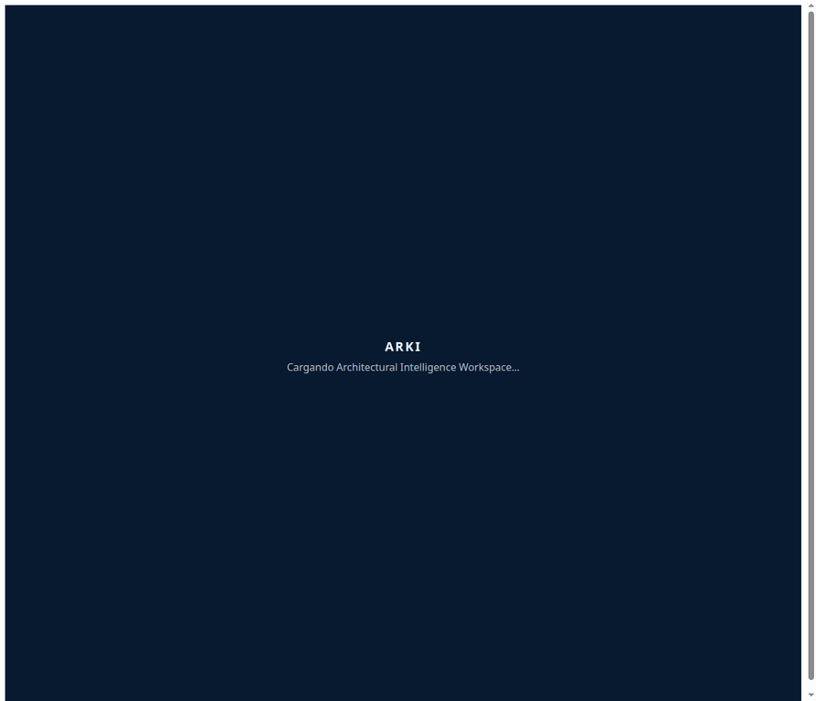

# ARKI UI Visual Contact Sheet — A0-V

Viewport: 1280×720. Browser: Manus Browser. These are the authentic screenshots captured during the audit.

## SCREEN-SHELL-001 — /

## SCREEN-DF-001 — /arki-design-funnel

## SCREEN-GEN-001 — /arki-generator

